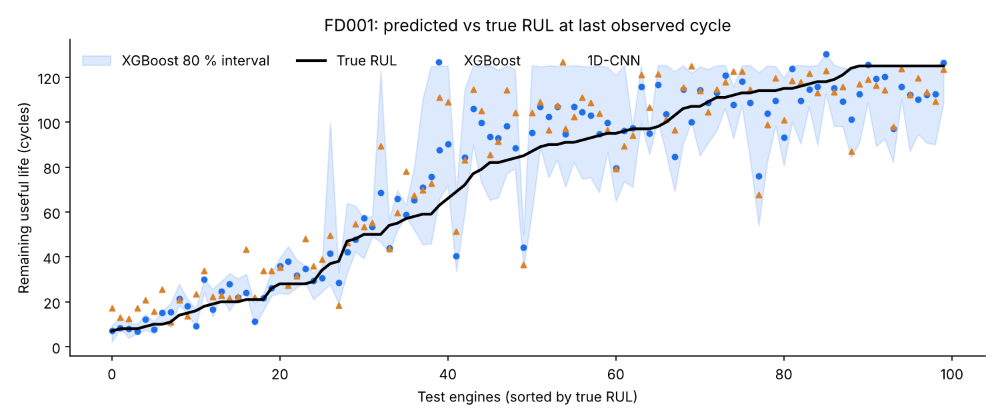
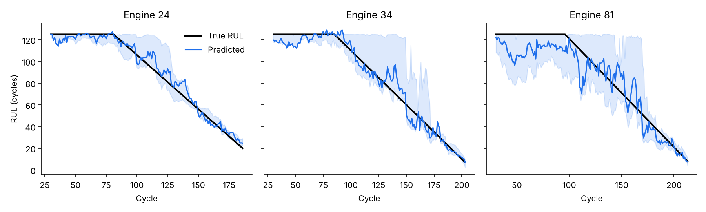

# Turbofan Engine Remaining Useful Life (RUL) Prediction

Predicting how many flight cycles a turbofan engine has left before failure, from its sensor history, on the NASA C-MAPSS benchmark. Each prediction comes with an 80 % interval, because a maintenance planner needs to know how much to trust the number before pulling an engine off the wing.


## Results

Official test protocol: one prediction per test engine at its last observed cycle, compared with NASA's true RUL. Mean ± standard deviation over 3 random seeds (`results/benchmark.csv`).

| Dataset | Model | RMSE (cycles) ↓ | NASA score ↓ | 80 % interval coverage |
|---|---|---|---|---|
| FD001 | Ridge regression (baseline) | 15.12 ± 0.09 | 396 ± 13 | 0.88 |
| FD001 | **XGBoost + quantile intervals** | **12.31 ± 0.23** | **218 ± 10** | 0.78 |
| FD001 | 1D-CNN + MC dropout | 15.61 ± 0.45 | 495 ± 74 | 0.43 |
| FD003 | Ridge regression (baseline) | 16.52 ± 0.11 | 502 ± 30 | 0.78 |
| FD003 | **XGBoost + quantile intervals** | **12.40 ± 0.14** | **270 ± 36** | 0.75 |
| FD003 | 1D-CNN + MC dropout | 15.65 ± 0.60 | 829 ± 123 | 0.57 |

For reference, Li, Ding & Sun (2018) report an RMSE of 12.61 on FD001 with a deep CNN, so the XGBoost model here is in the range of published deep-learning results while training in under 4 seconds on a laptop CPU.



### What the results show

- **Gradient-boosted trees on engineered window features beat the CNN** on this dataset size (100 training engines). The CNN is deliberately light; a deeper network with more tuning would close part of the gap, but the simpler model is also faster, easier to explain and better calibrated.
- **The intervals are useful, not decorative.** XGBoost quantile intervals cover 75–78 % of true values against an 80 % target. Monte-Carlo dropout intervals are far too narrow (43 %), a known weakness of that method worth knowing before relying on it.
- **Uncertainty shrinks as failure approaches.** Far from failure the interval is wide (degradation is not yet visible in the sensors); in the last ~50 cycles it narrows to a few cycles, which is when maintenance decisions are made.



## Method

1. **Labels**: piecewise-linear RUL capped at 125 cycles. Early in life the engine is healthy and the sensors carry no degradation signal, so predicting an exact large RUL is neither possible nor useful.
2. **Preprocessing**: constant sensors removed (15 of 21 kept on FD001), min-max scaling fitted on training engines only.
3. **Windows**: 30-cycle sliding windows. Tabular models get the last value, mean, standard deviation and linear trend of each sensor; the CNN gets the raw window.
4. **Validation**: 20 % of training engines held out *by engine*, never by row, to avoid leaking an engine's future into training. Used for CNN early stopping and linear-model interval calibration.
5. **Metrics**: RMSE and the asymmetric PHM08 score, which penalises late predictions (overestimating remaining life) more than early ones, since those are the dangerous errors in maintenance.

## Project structure

```
src/rul/
├── data.py        # loading, RUL labelling, engine-wise split, scaling
├── features.py    # sliding windows and window statistics
├── models.py      # Ridge, XGBoost (point + quantiles), 1D-CNN with MC dropout
├── metrics.py     # RMSE, NASA score, interval coverage
└── train.py       # CLI: train and score on the official test set
scripts/
├── download_data.py   # fetch C-MAPSS from the NASA PCoE repository
└── benchmark.py       # multi-seed benchmark + figures
dashboard/app.py       # Streamlit engine health dashboard
tests/test_rul.py      # 15 unit tests on synthetic engines (no download needed)
```

## Run it

```bash
pip install -r requirements.txt
python scripts/download_data.py                  # ~12 MB
python -m src.rul.train --dataset FD001          # one run, all models
python scripts/benchmark.py                      # full benchmark + figures (~4 min on CPU)
streamlit run dashboard/app.py                   # interactive dashboard
pytest tests                                     # unit tests
```

The dashboard lets you pick a test engine and shows its predicted RUL with interval, a maintenance status (healthy / plan / act now) and its sensor history.

## Limitations and next steps

- **FD002 and FD004** mix six operating conditions; they need per-regime normalisation before the same pipeline applies.
- **Physics-informed constraint**: RUL should only decrease over an engine's life. Adding a monotonicity penalty to the CNN loss is the natural next step, in line with my previous work on physics-informed networks for bearing health monitoring.
- **Calibrated intervals**: conformal prediction would guarantee coverage instead of approximating it.
- **From prediction to decision**: turn the RUL distribution into a maintenance slot choice by minimising expected cost (unplanned failure vs. early removal).

## Data

A. Saxena, K. Goebel, D. Simon, N. Eklund, "Damage Propagation Modeling for Aircraft Engine Run-to-Failure Simulation", PHM 2008. NASA Prognostics Center of Excellence data repository.

Li, X., Ding, Q., Sun, J.-Q. (2018). "Remaining useful life estimation in prognostics using deep convolution neural networks". *Reliability Engineering & System Safety*, 172, 1–11.

---

Alaa Eddine Tahir, engineering student at Arts et Métiers (ENSAM) · [LinkedIn](https://linkedin.com/in/alaaeddine-tahir)
